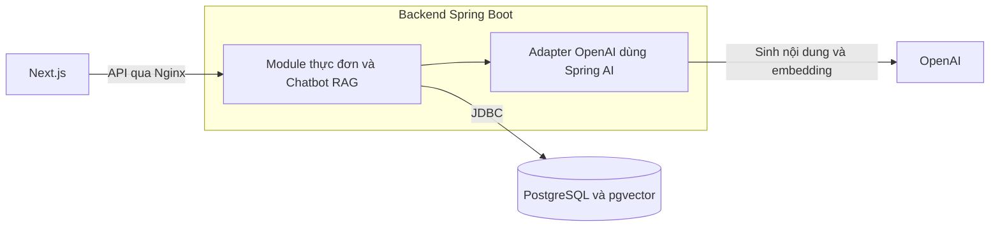

# NutriPlan — Nutrition Planner with Chatbot

Đồ án nhóm 9: website tư vấn dinh dưỡng cá nhân hóa. Phase 1 triển khai **tài khoản, hồ sơ và chỉ số**. AI tạo thực đơn và Chatbot RAG thuộc các phase tiếp theo.

## Chạy bằng Docker (khuyến nghị)

Cần Docker Desktop đang chạy, dùng Linux containers. Tại thư mục gốc:

```powershell
Copy-Item .env.example .env
docker compose up -d --build
```

Mở **http://localhost:3000**. API cùng origin qua Nginx. Lần build đầu cần tải image/dependency; chờ `http://localhost:3000/api/v1/health` trả `{"status":"UP"}`. Nếu cổng bị chiếm, đổi `APP_PORT` / `DB_PORT` trong `.env`.

Khi `DEMO_ENABLED=true`, backend tạo tài khoản mẫu nếu chưa có:

| Vai trò | Email | Mật khẩu mẫu trong `.env.example` |
|---|---|---|
| USER | user@example.test | DemoUser123! |
| ADMIN | admin@example.test | DemoAdmin123! |

Mật khẩu mẫu chỉ phục vụ demo cục bộ; đổi trong `.env` trước khi chạy lần đầu. Khi đổi biến môi trường sau khi tài khoản đã tồn tại, mật khẩu DB không bị ghi đè. Tài khoản mới đăng ký luôn có role USER. Phase 1 chưa có dashboard quản trị; ADMIN không được duyệt hồ sơ người khác.

`docker compose stop` dừng ứng dụng và giữ dữ liệu. **Không dùng `down -v` nếu muốn giữ database.** Khi chạy qua HTTPS, đặt `COOKIE_SECURE=true`; cấu hình reverse proxy TLS tại môi trường triển khai.

## Chạy để phát triển

Java 21, Node.js 24 và Docker. Maven Wrapper có sẵn, không cần Maven toàn cục.

```powershell
docker compose up -d db
# Terminal 1
cd backend
./mvnw.cmd spring-boot:run
# Terminal 2 (từ root)
cd frontend
npm ci
npm run dev
```

Frontend: http://localhost:3000; backend: http://localhost:8080. Next.js proxy `/api/*` tới backend (biến `API_ORIGIN`, mặc định localhost:8080). Không chạy gateway Docker trên cùng cổng với `npm run dev`. `.env` ở root được Compose đọc; khi chạy Maven trực tiếp, export các biến môi trường cần dùng. Mặc định dev dùng DB `nutrition`, user `nutrition`, password `local-development-only`, cổng 5433; tài khoản demo tắt, có thể đăng ký qua UI.

Trên Linux/macOS: dùng `./mvnw` thay cho `./mvnw.cmd` (`chmod +x backend/mvnw` nếu cần).

## Kiểm thử

```powershell
docker compose up -d db
cd backend
./mvnw.cmd verify
# Từ frontend
npm run typecheck
npm run lint
npm run build
# App phải đang chạy trước khi chạy Playwright
npx playwright install chromium
npm run test:e2e
```

Backend test dùng PostgreSQL thật, schema riêng **phase1_test**, và xóa dữ liệu tài khoản **chỉ trong schema đó** trước từng ca. Mặc định test dùng cổng 5433 với credentials của application.yml. Không hướng schema test vào dữ liệu thật. Test thường không gọi OpenAI.

Playwright đăng ký tài khoản `*@example.com` giả, kiểm tra lưu/tải lại hồ sơ, đổi mật khẩu, đăng xuất, phiên cũ và bố cục ở 360/768/1440. Test trình duyệt tạo dữ liệu trên database app đang chạy; chỉ chạy với môi trường demo. Đổi URL bằng `$env:E2E_BASE_URL='http://localhost:3001'`. Ảnh và trace ở `frontend/test-results`, báo cáo HTML ở `frontend/playwright-report`.

Kiểm tra dữ liệu mẫu (Python + `pypdf`): `python scripts/verify-fixtures.py`.

## API Phase 1

OpenAPI JSON: `/api/v1/openapi`; Swagger UI: `/api/v1/docs` trên gateway Docker, hoặc http://localhost:8080/api/v1/docs khi dev.

| Method | Endpoint | Chức năng |
|---|---|---|
| GET | /api/v1/health | Kiểm tra kết nối DB |
| GET | /api/v1/auth/csrf | Lấy token + tên header CSRF |
| POST | /api/v1/auth/register | Đăng ký email/mật khẩu/tên |
| POST | /api/v1/auth/login | Đăng nhập, phát cookie HttpOnly |
| GET | /api/v1/auth/me | Tài khoản hiện tại và sessionContext |
| POST | /api/v1/auth/logout | Thu hồi phiên hiện tại |
| POST | /api/v1/auth/change-password | Đổi mật khẩu, thu hồi mọi phiên |
| GET / PUT | /api/v1/me/profile | Đọc/lưu hồ sơ của người đăng nhập |
| DELETE | /api/v1/me/profile?expectedVersion={version} | Bỏ hồ sơ hiện tại, giữ lịch sử trong DB |
| GET | /api/v1/me/metrics | Snapshot chỉ số cùng phiên bản quy tắc |
| GET | /api/v1/ingredients | Đọc danh mục định danh nguyên liệu mẫu |

Mọi POST/PUT cần header CSRF từ `/auth/csrf`. Các thao tác đã xác thực cần thêm **`X-Session-Context`** từ `/auth/login` hoặc `/auth/me`, ngăn tab cũ ghi dữ liệu vào tài khoản vừa đổi. Header này không dùng để xác định chủ sở hữu: backend chỉ lấy chủ sở hữu từ cookie phiên đã xác thực. Phiên ngẫu nhiên 256 bit, lưu hash SHA-256 trong DB, hết hạn sau 8 giờ; kiểm tra tài khoản ACTIVE mỗi request.

Hồ sơ cơ bản gồm ngày sinh, nhóm hệ số công thức, chiều cao, cân nặng, mức vận động và mục tiêu. Người dùng có thể tạo, xem, sửa và xóa hồ sơ hiện tại. Khi lưu, gửi `expectedVersion` (0 nếu chưa có hồ sơ hiện tại). Khi sửa hoặc xóa gặp xung đột phiên bản, API trả 409 và giao diện cho tải lại. Backend lưu một phiên bản mới khi cập nhật và giữ lịch sử. Người từ 18 tuổi nhận chỉ số ước tính theo tuổi tại lần lưu.

## Sao lưu và khôi phục thử

Ví dụ PowerShell, mặc định user/database `nutrition`; sửa tên tương ứng nếu đổi `.env`:

```powershell
New-Item -ItemType Directory -Force backups
docker compose exec -T db pg_dump -U nutrition -d nutrition --exclude-schema=phase1_test -Fc -f /tmp/nutrition.dump
docker compose cp db:/tmp/nutrition.dump ./backups/nutrition.dump
# Khôi phục vào database MỚI, không ghi đè database đang dùng
docker compose exec -T db createdb -U nutrition nutrition_restore_check
docker compose exec -T db pg_restore -U nutrition -d nutrition_restore_check --no-owner /tmp/nutrition.dump
docker compose exec -T db psql -U nutrition -d nutrition_restore_check -c 'SELECT count(*) FROM users;'
```

Nếu khôi phục từ file đã lưu trên máy: `docker compose cp ./backups/nutrition.dump db:/tmp/nutrition.dump` trước bước restore. Dùng một tên database mới nếu `nutrition_restore_check` đã tồn tại. File backup chứa dữ liệu tài khoản, không commit. Khôi phục ứng dụng thật cần cấu hình `DATABASE_URL`/`POSTGRES_DB` trỏ tới DB đã kiểm tra.

## Cấu trúc và tài liệu

- `backend/`: Spring Boot 3.5, Java 21, Spring Security, JDBC, Flyway.
- `frontend/`: Next.js 16, TypeScript, Tailwind CSS; UI tiếng Việt.
- `infra/nginx.conf`: cùng origin cho frontend và API.
- `docs/AGENTS.md`: nguyên tắc toàn dự án.
- [Kế hoạch 6 phase](docs/Ke_hoach_TTCS_6_phase_va_User_Story.md) ghi lịch tích hợp Spring AI và tiêu chí nghiệm thu.
- `docs/PHASE1.md`: quyết định, sơ đồ, truy vết và giới hạn.
- `docs/fixtures/`: 3 món mẫu có nguồn + PDF và câu hỏi/trang.
- `docs/TEST_RESULTS.md`: bằng chứng từ lần chạy thực tế.

### Kiến trúc AI dự kiến cho Phase 2–3



Phase 2 dùng Spring AI để gợi ý bữa ăn tham khảo cho một ngày theo kcal mục tiêu và mục tiêu dinh dưỡng trong hồ sơ cơ bản. Backend kiểm tra đầu ra và hiển thị tổng kcal ước tính cạnh mục tiêu. Gợi ý không kiểm tra dị ứng, thực phẩm loại trừ hoặc ngân sách.

Phase 3 dùng cùng adapter cho embedding và hỏi đáp RAG. Người dùng có thể trao đổi về dị ứng, thói quen ăn uống và tình trạng cá nhân trong hội thoại. Backend truy xuất đoạn từ PDF đã duyệt và xác minh mã đoạn trước khi hiển thị trích dẫn. Phase 4 cho phép xem lại và hỏi Chatbot về gợi ý đã lưu.

Phase 1 chạy với các biến OpenAI để trống. Lần gọi OpenAI thật đầu tiên được lên lịch ở Phase 2. Tạo thực đơn, RAG, chat, tiến trình và quản trị mở rộng thuộc các phase tiếp theo.
