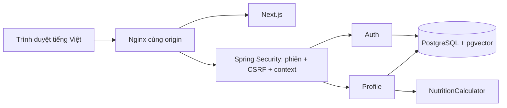
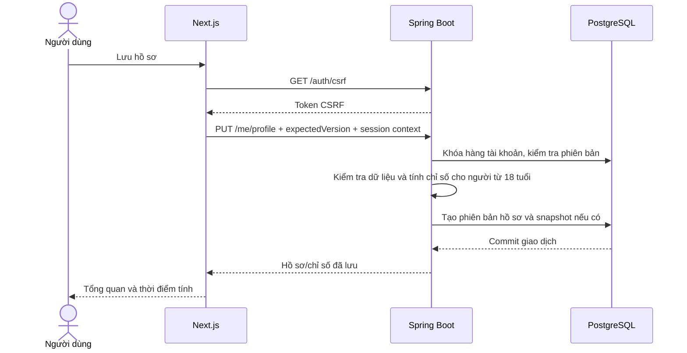

# Phase 1 — thiết kế và cài đặt

Ngày triển khai: 16/11/2026. Phạm vi: US01, US02, US04; người dùng đã chọn thêm đăng ký/đổi mật khẩu ngay Phase 1. **Lần kiểm tra OpenAI thật chuyển sang Phase 2 theo xác nhận của người dùng.**

## Quyết định triển khai

- Một backend Spring Boot 3.5.16, Java 21, Maven Wrapper 3.9.11, JDBC và Flyway SQL. Không dựng service AI riêng.
- Frontend Next.js 16.4.6, TypeScript, Tailwind CSS, CSS riêng cho giao diện; không có UI library bổ sung.
- PostgreSQL 17 + pgvector, Nginx cùng origin, Docker Compose. Image DB dùng tag pg17; cần pin digest khi đóng băng bản nộp.
- Phiên phía server là bảng `sessions`, tích hợp Spring Security bằng filter. Cookie chứa token ngẫu nhiên 32 byte; DB chỉ giữ hash. Không dùng JWT hoặc localStorage để giữ credentials. Không sử dụng thêm bảng Spring Session ngoài thiết kế.
- CSRF cookie HttpOnly + token trong JSON. `X-Session-Context` là UUID phiên, chỉ kiểm tra form thuộc phiên hiện tại, không trao quyền và không chọn chủ sở hữu. Cookie vẫn là nguồn xác thực duy nhất. Thay đổi đăng nhập thông báo tab khác qua storage event không chứa dữ liệu riêng.
- Hồ sơ Phase 1 gồm ngày sinh, nhóm hệ số công thức, chiều cao, cân nặng, mức vận động và mục tiêu. `users.status` dùng ACTIVE/LOCKED.
- Snapshot giữ tuổi lúc tính trong `age_years`. Schema giữ các cột cũ như `self_declared_healthy` và `unresolved_allergies` để tương thích với dữ liệu lịch sử.
- Số đo dương, tối đa 300 cm / 500 kg; tối đa 3 chữ số thập phân; tuổi nhập 0–120. Đây là miền nhập của bản demo, không phải ngưỡng y khoa. Kết quả vượt `NUMERIC(12,3)` hoặc REE không dương bị báo lỗi tại trường.
- Lưu hồ sơ tạo phiên bản mới. Xóa hồ sơ hiện tại bỏ đánh dấu phiên bản hiện tại và giữ lịch sử trong DB. Cả hai thao tác đều khóa hàng tài khoản và kiểm tra `expectedVersion`. Snapshot quy tắc lấy từ DB, với đầu ra làm tròn 3 chữ số, HALF_UP.
- Tuổi tính từ ngày sinh. Hồ sơ dưới 18 tuổi vẫn lưu được. Các chỉ số của dự án được tính cho tuổi từ 18. Hồ sơ cũ chưa có snapshot có thể lưu lại để nhận chỉ số nếu đủ tuổi.
- Migration V4 cho phép hồ sơ mới bỏ trống các cờ sức khỏe cũ và giữ dữ liệu lịch sử. Hệ thống dừng tạo bản ghi thói quen ăn uống và dị ứng khi lưu hồ sơ. Các chủ đề đó thuộc ngữ cảnh Chatbot ở Phase 3.
- `nutrition_rule_versions` chọn `phase1-v1` trong Phase 1; tham số bên trong đọc từ JSONB. Chưa có UI chỉnh quy tắc. Khi thêm phiên bản sau, không sửa bản đã được sử dụng.

## Kiến trúc và luồng

## ERD phần đã cài đặt (10 bảng nghiệp vụ)

Flyway giữ các bảng sở thích ăn uống và dị ứng để bảo toàn dữ liệu cũ. Hồ sơ mới không ghi vào các bảng này.

## Truy vết

| Yêu cầu | Module/API/UI | Kiểm thử và bằng chứng |
|---|---|---|
| US01, FR01 | auth, đăng ký/đăng nhập/đăng xuất/đổi mật khẩu | Phase1ApiTest: registration, password_change, concurrent_login; Playwright toàn luồng |
| FR02, NFR04 | SecurityConfig, SessionService, API `/me/*` | CSRF, truy cập chéo, role ADMIN bị chặn đối với USER, khóa/hết hạn phiên, stale_tab |
| US02, FR03 | ProfileInput/Service và form hồ sơ cơ bản | tạo, sửa, xóa hồ sơ hiện tại, kiểm tra số đo, mốc 18 tuổi và xung đột phiên bản |
| US04, FR04 | NutritionCalculator, snapshot, dashboard | số tính tay nam 30 tuổi và nữ tăng cơ; snapshot/rule version; đổi tham số nước |
| NFR09 | giao dịch và expectedVersion | private_profile history, concurrent_profile_saves |
| NFR08 | UI tiếng Việt, keyboard, responsive | Playwright login/profile/dashboard/password ở 360/768/1440; ảnh thực tế |
| NFR10 | Maven, Flyway, OpenAPI, Compose | `mvnw verify`, frontend checks/build, Docker smoke |
| NFR12 | PostgreSQL dump/restore | khôi phục sang DB độc lập, kết quả ở TEST_RESULTS |
| Chuẩn bị Phase 2/3 | fixture 3 món + PDF | `scripts/verify-fixtures.py`; nguồn/trang trong fixtures/README |

Mã TC là nhóm kiểm thử theo AGENTS.md, không tự nhận đã đạt toàn bộ TC01…TC15 của 6 phase. Bằng chứng và phạm vi chính xác xem `TEST_RESULTS.md`.

## Chưa thuộc phần đã cài đặt

Phase 1 chưa triển khai gợi ý bữa ăn, RAG/embedding, Chatbot, tiến trình và UI quản trị. Hai tài khoản mẫu phục vụ demo. Quản trị viên hiện chỉ có xác thực, role và dữ liệu riêng. Hiệu năng p95 và cài trên máy thứ hai chưa đánh giá. Xem [kế hoạch 6 phase](Ke_hoach_TTCS_6_phase_va_User_Story.md) để biết phạm vi bàn giao hiện hành.

Phần dinh dưỡng, giá và PDF fixture đã ghi nguồn và giới hạn riêng. Lần gọi OpenAI thật được người dùng dời sang Phase 2, do đó Phase 1 không cần khóa API/model và không có lời gọi AI thật trong test.
