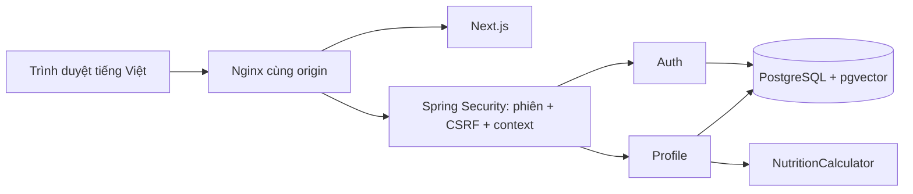
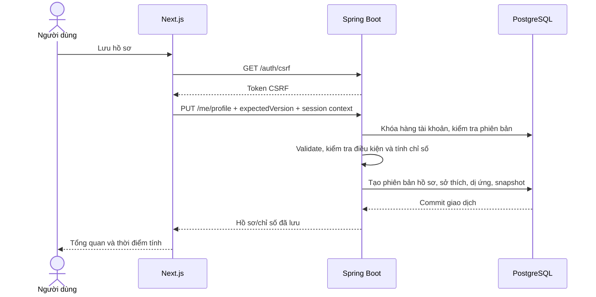
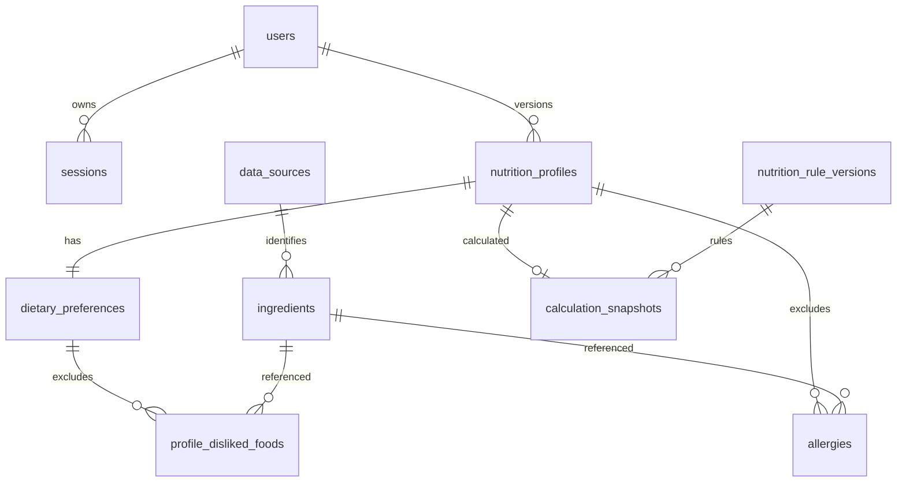

# Phase 1 — thiết kế và cài đặt

Ngày triển khai: 16/11/2026. Phạm vi: US01, US02, US04; người dùng đã chọn thêm đăng ký/đổi mật khẩu ngay Phase 1. **Lần kiểm tra OpenAI thật chuyển sang Phase 2 theo xác nhận của người dùng.**

## Quyết định triển khai

- Một backend Spring Boot 3.5.16, Java 21, Maven Wrapper 3.9.11, JDBC và Flyway SQL. Không dựng service AI riêng.
- Frontend Next.js 16.4.6, TypeScript, Tailwind CSS, CSS riêng cho giao diện; không có UI library bổ sung.
- PostgreSQL 17 + pgvector, Nginx cùng origin, Docker Compose. Image DB dùng tag pg17; cần pin digest khi đóng băng bản nộp.
- Phiên phía server là bảng `sessions`, tích hợp Spring Security bằng filter. Cookie chứa token ngẫu nhiên 32 byte; DB chỉ giữ hash. Không dùng JWT hoặc localStorage để giữ credentials. Không sử dụng thêm bảng Spring Session ngoài thiết kế.
- CSRF cookie HttpOnly + token trong JSON. `X-Session-Context` là UUID phiên, chỉ kiểm tra form thuộc phiên hiện tại, không trao quyền và không chọn chủ sở hữu. Cookie vẫn là nguồn xác thực duy nhất. Thay đổi đăng nhập thông báo tab khác qua storage event không chứa dữ liệu riêng.
- `users.status`: ACTIVE/LOCKED; `ingredients.status`: ACTIVE/INACTIVE. `severity=UNSPECIFIED`: mọi dị ứng được loại trừ, không tự suy luận mức độ. Diet: OMNIVORE/VEGETARIAN/VEGAN. Phase 1 chỉ có flag EGG trong mẫu, danh mục đầy đủ chốt ở Phase 2.
- Bổ sung `self_declared_healthy` để thực thi điều kiện khỏe mạnh; `unresolved_allergies` giữ nội dung chưa ánh xạ; `age_years` giữ tuổi tại lần tính. Thêm `token_hash`, `created_at` cho phiên và thời điểm tạo tài khoản/hồ sơ. Đây là thay đổi so với schema đề xuất, không sửa lịch sử gốc.
- Số đo dương, tối đa 300 cm / 500 kg; tối đa 3 chữ số thập phân; tuổi nhập 0–120. Đây là miền nhập của bản demo, không phải ngưỡng y khoa. Kết quả vượt `NUMERIC(12,3)` hoặc REE không dương bị báo lỗi tại trường.
- Phiên bản hồ sơ tăng trong giao dịch có khóa hàng users. Hai lần lưu cùng `expectedVersion` chỉ một lần thành công. Snapshot quy tắc lấy từ DB, chỉ làm tròn đầu ra 3 chữ số, HALF_UP.
- Người ngoài phạm vi vẫn lưu hồ sơ nhưng không sinh chỉ số/mục tiêu cá nhân. Không nhận tên/email/hồ sơ thật trong dữ liệu mẫu. Dị ứng chưa rõ vẫn lưu và cảnh báo; chặn tạo thực đơn sẽ là trách nhiệm Phase 2.
- Tham chiếu dữ liệu tài khoản/hồ sơ dùng ON DELETE CASCADE; nguyên liệu và quy tắc được snapshot tham chiếu dùng RESTRICT. Chưa triển khai chức năng xóa tài khoản (P2).
- `nutrition_rule_versions` chọn `phase1-v1` trong Phase 1; tham số bên trong đọc từ JSONB. Chưa có UI chỉnh quy tắc. Khi thêm phiên bản sau, không sửa bản đã được sử dụng.

## Kiến trúc và luồng

## ERD phần đã cài đặt (10 bảng nghiệp vụ)

Flyway tạo thêm bảng kỹ thuật `flyway_schema_history`. Không tuyên bố đã triển khai toàn bộ thiết kế 30 bảng.

## Truy vết

| Yêu cầu | Module/API/UI | Kiểm thử và bằng chứng |
|---|---|---|
| US01, FR01 | auth, đăng ký/đăng nhập/đăng xuất/đổi mật khẩu | Phase1ApiTest: registration, password_change, concurrent_login; Playwright toàn luồng |
| FR02, NFR04 | SecurityConfig, SessionService, API `/me/*` | CSRF, truy cập chéo, role ADMIN bị chặn đối với USER, khóa/hết hạn phiên, stale_tab |
| US02, FR03 | ProfileInput/Service, form hồ sơ | validation, ineligible_profiles, inactive_ingredient, extreme_measurement |
| US04, FR04 | NutritionCalculator, snapshot, dashboard | số tính tay nam 30 tuổi và nữ tăng cơ; snapshot/rule version; đổi tham số nước |
| NFR09 | giao dịch và expectedVersion | private_profile history, concurrent_profile_saves |
| NFR08 | UI tiếng Việt, keyboard, responsive | Playwright login/profile/dashboard/password ở 360/768/1440; ảnh thực tế |
| NFR10 | Maven, Flyway, OpenAPI, Compose | `mvnw verify`, frontend checks/build, Docker smoke |
| NFR12 | PostgreSQL dump/restore | khôi phục sang DB độc lập, kết quả ở TEST_RESULTS |
| Chuẩn bị Phase 2/3 | fixture 3 món + PDF | `scripts/verify-fixtures.py`; nguồn/trang trong fixtures/README |

Mã TC là nhóm kiểm thử theo AGENTS.md, không tự nhận đã đạt toàn bộ TC01…TC15 của 6 phase. Bằng chứng và phạm vi chính xác xem `TEST_RESULTS.md`.

## Chưa thuộc phần đã cài đặt

AI tạo thực đơn, MealPlanValidator, RAG/embedding, Chatbot, đổi món, tiến trình, UI quản trị và các mục P2. Hai tài khoản mẫu phục vụ demo; quản trị viên hiện chỉ có xác thực/role và dữ liệu riêng của mình. 100 thực phẩm/50 món/10 tài liệu là mục tiêu toàn đồ án, không phải số lượng đã hoàn thành ở Phase 1. Hiệu năng p95 và cài trên máy thứ hai chưa đánh giá.

Phần dinh dưỡng, giá và PDF fixture đã ghi nguồn và giới hạn riêng. Lần gọi OpenAI thật được người dùng dời sang Phase 2, do đó Phase 1 không cần khóa API/model và không có lời gọi AI thật trong test.
